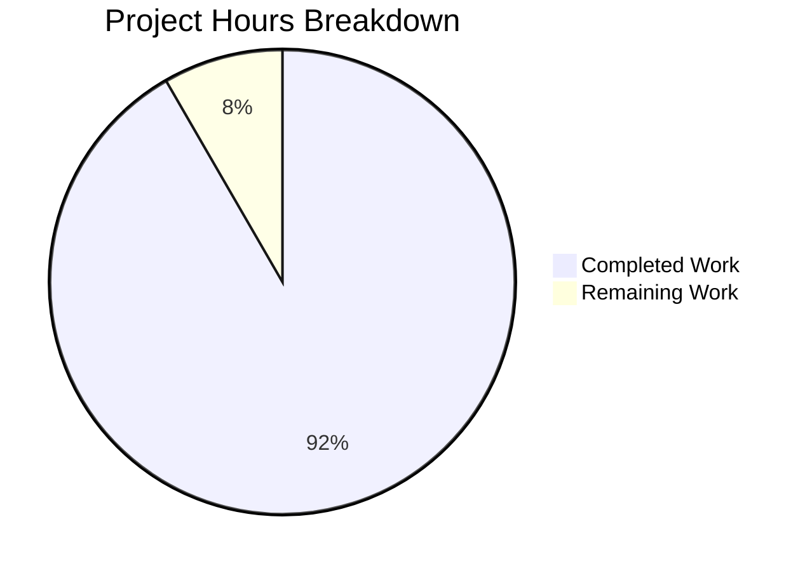

# 1. Executive Summary

Where the project stands: what was delivered, what was proven, what remains.

## 1.1 Project Overview

`Welcome to Blitzy` is a single-statement Node.js console program: run `node index.js` from the repository root and it writes the literal text `Welcome to Blitzy` to standard output, unformatted, then exits 0. The repository holds exactly two files — the program and a three-line README with its prerequisite and run command — for a requester who wants that line printed with the smallest possible diff: no dependency, no build step, no configuration, no pipeline. There is no interface, service, endpoint, datastore or credential.

## 1.2 Completion Status

**Completion calculation:** (Completed ÷ (Completed + Remaining)) × 100 = (11.0 ÷ 12.0) × 100 = **91.7% complete**.



Chart colours: Completed Work = Dark Blue (#5B39F3); Remaining Work = White (#FFFFFF).

| Metric | Hours |
|---|---|
| Total Hours | 12.0 |
| Completed Hours (AI + Manual) | 11.0 |
| Remaining Hours | 1.0 |

Every deliverable in the agreed scope is present and byte-exact, and every behaviour it promises was exercised. The remaining hour covers two confirmations, not missing functionality.

## 1.3 Key Accomplishments

- ✅ One-statement program printing `Welcome to Blitzy` to stdout, byte-exact.
- ✅ Output exactly 18 bytes, empty stderr, exit status 0.
- ✅ No colour, envelope, prefix, label, timestamp or banner.
- ✅ No dependency, install step, build step, manifest or configuration.
- ✅ Arguments it never reads are ignored; output is locale-independent.
- ✅ Identical through redirect, pipe, `tee` and a delayed reader.
- ✅ Deterministic across repeats, safe under concurrent runs, no residue.
- ✅ A three-line README with the prerequisite and the single run command.

## 1.4 Critical Unresolved Issues

**3 of 20 scoped items remain open** — 17 requirements the work was measured against plus 3 path-to-production checks. 17 are met, one with a caveat needing a decision rather than a fix. None blocks release.

| Issue | Impact | Owner | ETA |
|---|---|---|---|
| Runtime prerequisite confirmed only on the development host (Node.js v22.23.3) — the deployment host's `node` version and byte-exact output are unconfirmed | The program cannot start where no Node.js 22-or-later runtime is present | Deployment host owner | 0.5 h |
| The run instruction is root-relative and does not name the working directory: `node index.js` from another directory exits 1 with `Cannot find module` | A reader who is not in the repository root sees a module error rather than the line; the instruction is accurate only for the root it presupposes | Repository maintainer | 0.5 h |
| The stated runtime floor "Node.js 22 or later" is a moving reference with no automated guard | The statement ages as the Node.js support cycle moves; nothing in the repository will notice | Repository maintainer | Shared with the row above |

## 1.5 Access Issues

**No access issues identified.** No credential, API key, service account, repository permission, database or third-party access is needed, and no environment variable or secret is consumed. The only prerequisite is a Node.js 22-or-later runtime on the host that runs it.

## 1.6 Recommended Next Steps

1. [High] Confirm on the deployment host that `node --version` reports 22 or later and that the documented command writes the exact line.
2. [Medium] Keep the acceptance reference: digest `edf634f042214722c7379dc3da493820`, 18 bytes, empty stderr, exit 0.
3. [Medium] Decide whether the run instruction should name the repository root it presupposes.
4. [Low] Re-check the stated Node.js baseline at the next support-cycle change.
5. [Low] Treat the byte-compared run as the only guard on future edits.

# 2. Project Hours Breakdown

Hours are measured against the agreed scope only: the two files the request defines and the path-to-production checks they imply.

## 2.1 Completed Work Detail

| Component | Hours | Description |
|---|---|---|
| Print program — `index.js` | 2.0 | The single statement written to its exact accepted bytes, as an unwrapped CommonJS top-level statement: the literal `Welcome to Blitzy`, conventional spacing, double quoting and terminating semicolon, no dependency, no build step, no configuration, and no comment, shebang, export or argument parser. |
| Install/run documentation — `README.md` | 1.0 | The three-line file: heading, and one sentence carrying the runtime prerequisite (Node.js 22 or later) and the single run command, within the five-line limit and with no contributing, license, testing, deployment, architecture or table-of-contents section. |
| Two-file scope and artifact boundary | 1.0 | Exactly two root paths changed — the program added, the README updated in place — with no third file, no directory, nothing pre-existing refactored, renamed or reformatted, and every artifact the request excludes left absent. |
| Byte-exact acceptance and runtime verification | 7.0 | Byte-level confirmation of the exact stdout stream, empty stderr and exit status, plus the executed battery: output fidelity, argument robustness, environment and locale independence, stream-capture and consumer behaviour, static parse and CommonJS load, repeatability and concurrency, and side-effect and repository integrity. |
| **Total** | **11.0** | Matches Completed Hours in Section 1.2. |

## 2.2 Remaining Work Detail

| Category | Hours | Priority |
|---|---|---|
| Runtime prerequisite and byte-exact acceptance confirmed on the deployment host, not only on the development host | 0.5 | Medium |
| Documentation close-out: decide whether the run instruction names the working directory it presupposes, and re-validate the stated Node.js baseline | 0.5 | Low |
| **Total** | **1.0** | Matches Remaining Hours in Section 1.2 and the Section 7 chart. |

Both rows are confirmations and decisions of bounded scope, not missing functionality. Neither can be closed by adding a test, linter, manifest or pipeline: the request forbids each of those, so the work is deliberately manual.

## 2.3 Hours Calculation Basis and Confidence

**Calculation basis.** Total project hours are the sum of the completed work above (11.0 h) and the remaining work above (1.0 h) = 12.0 h. The completion figure follows the hours formula: (11.0 ÷ 12.0) × 100 = 91.7%, and the same three numbers (11.0 / 1.0 / 12.0) feed Sections 1.2 and 7.

**How each completed figure was sized.** Implementation hours follow what the work actually required rather than a generic base rate: this deliverable has one statement and one sentence, and no entity, integration, migration or configuration surface to size. The verification figure dominates because correctness here is a byte-level property — the exact 18-byte stdout on file descriptor 1, an empty stderr and exit status 0 — and the only way to establish it is to run the program and compare bytes across the contexts it can be invoked in. The executed battery behind that figure is listed row by row in Section 3.

**Confidence.** High for the completed 11.0 h: every claim rests on bytes, file hashes, and runs performed against the delivered files, not on inference. Medium for the remaining 1.0 h: both items are small and well bounded, but the deployment-host confirmation depends on a host outside this repository, and the documentation decision depends on the maintainer's preference for wording that is currently fixed.

# 3. Test Results

The project ships no test framework by requirement, so the checks below are the executable gate itself — the documented run, byte-compared against its expected stream — plus the battery built around it. Every row was executed against the delivered files, and the counts are the observed results: **40 checks executed, 40 passed, 0 failed.**

| Area / Category | Framework | Tests | Passed | Failed | Coverage | What This Proves |
|---|---|---|---|---|---|---|
| Output fidelity and exact bytes (`index.js`) | Node.js 22 runtime, byte comparison against `Welcome to Blitzy\n` | 6 | 6 | 0 | Not measured (no instrumentation) | stdout is exactly 18 bytes of plain text on file descriptor 1 — 17 printable ASCII characters and one newline, no colour, envelope, prefix, banner or surrounding character — with exit status 0 and an empty stderr |
| Argument robustness (no argument parser present) | Node.js 22 runtime, shell harness | 10 | 10 | 0 | Not measured (no instrumentation) | options-like, empty, oversized, unicode, format-specifier and injection-payload arguments are all ignored: the same byte stream, the same exit status, no file created by any payload |
| Environment and locale independence | Node.js 22 runtime under an empty environment and four locales | 7 | 7 | 0 | Not measured (no instrumentation) | no environment variable, configuration file or locale is read; the run succeeds identically with an empty environment, a PATH-only environment, no `HOME`, and C/C.UTF-8/POSIX/bogus locales |
| Stream capture and consumer behaviour | Redirect, pipe, `tee`, delayed reader, discarded stdout | 8 | 8 | 0 | Not measured (no instrumentation) | the line survives every standard consumer — redirect, `| cat`, `| cmp` byte-for-byte, `tee` — is delivered in full to a reader that arrives a second late, and leaves nothing behind when discarded |
| Static parse gate and module load | `node --check`; CommonJS `require()` | 2 | 2 | 0 | Not measured (no instrumentation) | the file parses as written and loads as a CommonJS module with no manifest, no flag and no rename needed |
| Repeatability and concurrency | Digest comparison across sequential repeats, four simultaneous runs, timeout wrapper | 3 | 3 | 0 | Not measured (no instrumentation) | the output is deterministic — one distinct digest across repeats — safe under concurrent invocation, and the process terminates on its own rather than lingering |
| Side-effect and repository integrity | Tree and working-state diff around the whole battery | 4 | 4 | 0 | Not measured (no instrumentation) | the runs write no file, temp file, cache or log; the working tree is unchanged; the repository still holds exactly two tracked files |

**Not Covered** — no test exercises these, and a human should confirm them before relying on the program in a new context:

- **Closed or failing stdout.** What happens when the reader closes the pipe early is not exercised as a requirement, and the program neither detects nor reports it; the exit status is unaffected. A consumer must not expect a non-zero exit for a closed pipe.
- **Signals, uncaught exceptions, error and 404 handlers, logging, environment-variable configuration and input validation.** None exists and none is exercised; each is excluded by the request, so nothing is missing — but no test asserts absence either.
- **Direct execution `./index.js`.** Not supported: the file carries no shebang and is not executable. The program is exercised only through `node index.js`.
- **A run from a directory other than the repository root.** Observed once for information: it exits 1 with `Cannot find module`. The documented flow presupposes the repository root.
- **Any browser, HTTP, datastore or third-party surface.** None exists, so nothing of that kind is exercised: there is no screen, route, port, query, credential or external service to test.
- **The runtime prerequisite on the deployment host.** The stated Node.js 22-or-later floor is confirmed against the runtime used here (v22.23.3) and nowhere else.
- **Automated regression protection.** No suite, linter or pipeline may exist in this repository, so nothing here re-runs by itself after a future change; the byte-compared run in Section 9 is the manual substitute.

# 4. Runtime Validation & UI Verification

The program has no screens, routes, ports or external services, so the runtime validation below is the console flow itself, driven from the repository root. `✅` means exercised and operational, `⚠` means exercised with a caveat, `❌` means deliberately not exercised.

- ✅ **Start-up and exit** — `node index.js` from the repository root starts, prints and exits 0 on its own; a timeout-wrapped run never has to be interrupted.
- ✅ **Primary flow: the printed line** — stdout is exactly 18 bytes, `Welcome to Blitzy` plus one newline, byte-identical to the expected stream on every run; stderr is empty.
- ✅ **No formatting path** — the emitted bytes contain no escape sequence, colour code, envelope, prefix, label, timestamp or banner, and none is produced even when stdout is a real terminal.
- ✅ **Argument path** — options-like, empty, 1000-argument, 10 000-character, unicode and injection-payload invocations all produce the identical line and exit 0; nothing is interpreted and no payload writes a file.
- ✅ **Environment and configuration path** — an empty environment, a PATH-only environment, no `HOME` and four locales all produce identical bytes; no variable, config file or secret is read.
- ✅ **Consumer integration** — redirect, pipe, `tee` and a reader arriving a second late all capture the full line; discarded output changes nothing; the sole interface is file descriptor 1.
- ✅ **Repeatability and concurrency** — five sequential runs and four simultaneous runs yield one identical digest with empty stderr; the runs leave no residue in the tree.
- ✅ **Manual regression gate** — `node index.js | md5sum` = `edf634f042214722c7379dc3da493820` with 18 bytes on stdout, empty stderr and exit 0; this is the reference an edit must reproduce.
- ⚠ **Invocation from another working directory** — the documented command is root-relative: run elsewhere it exits 1 with `Cannot find module`; the same file by absolute path prints the identical line. The instruction presupposes the repository root (Section 1.4).
- ❌ **Never exercised at runtime** — closed or failing stdout (EPIPE) and consumer-side early exit, signals, uncaught exceptions, error or 404 handling, logging, environment-variable configuration and input validation: none exists and none is exercised, each excluded by the request. There is likewise no browser surface, HTTP endpoint, datastore or third-party integration to drive, and no port to listen on.

# 5. Compliance & Quality Review

Compliance is assessed against the agreed scope — the request's own constraints and the technical specification written for it — and reports where the delivered repository stands now.

## 5.1 Compliance Matrix

| Deliverable / Requirement | Benchmark | Status | Evidence |
|---|---|---|---|
| Print program, output fidelity | The exact literal `Welcome to Blitzy`, unformatted, on stdout | ✅ Pass | `index.js:1`; 18-byte stdout, 6/6 fidelity checks |
| Line and token minimalism | Fewest lines and tokens for a correct form | ✅ Pass | 1 line, 34 bytes, one statement and one semicolon; no wrapper, guard or comment |
| Change footprint | Two files, smallest possible diff, nothing pre-existing refactored or renamed | ✅ Pass | `A index.js`, `M README.md`, 4 insertions and 1 deletion, no third path, no directory |
| Dependency policy | No declared or installed package | ✅ Pass | No import in the file; no manifest, lockfile or `node_modules` at the root or three levels up |
| Build policy | The file executes as written | ✅ Pass | `node index.js` runs directly; no transpile, bundler or generated artifact |
| Configuration and hardening policy | No environment configuration, logging, error or 404 handling, validation or security control | ✅ Pass | Grep-clean; identical output under an empty environment, PATH-only, no `HOME` and four locales |
| Test and pipeline policy | No test file, framework, coverage target or CI workflow | ✅ Pass (by requirement) | Zero test and workflow files; the cost is no automated regression net (Section 6) |
| Exact file contents | `index.js` and `README.md` byte-exact to the accepted blocks, newline-terminated | ✅ Pass | Blobs `651ed997…` and `564f3160…`; 34 and 111 bytes |
| Documentation deliverable | README of three lines, under a five-line cap, no extra sections | ✅ Pass | One heading, one blank line, one sentence; no contributing, license, testing, deployment, architecture or contents section |
| Run-instruction accuracy | Accurate runtime baseline and run command | ✅ Pass with caveat | Version accurate against v22.23.3; the working directory it presupposes is unnamed (Section 1.4) |
| Repository cleanliness | Zero forbidden artifacts; no directory created | ✅ Pass | 28 named artifact classes probed and absent; tree holds exactly the two deliverables |
| Runtime behaviour | stdout on file descriptor 1, exit 0, no side effect | ✅ Pass | Redirect, pipe, `tee`, delayed reader and discarded output all identical; no file, temp file or socket |

## 5.2 AAP & Rule Divergences and Gaps

| # | What the AAP/Rule Required | What Was Delivered Instead | Why It Diverged | Impact | Remediation |
|---|---|---|---|---|---|
| 1 | `README.md` change mode **CREATE** in the deliverable mapping | An in-place **update** at the same path, with content verbatim from the fixed block | The file already existed at the base commit holding the placeholder title `# 20octfornewproductgit`; a file already on disk cannot be created, and an in-place replacement still satisfies the smallest-diff constraint (Sanctioned) | None to path, content, purpose or priority; only the mapping's operation column no longer matches reality | None. Update the mapping's operation column if the plan is ever revised |
| 2 | User directive: make the smallest diff and perform no unrelated reformatting of existing content | The README's pre-existing title `# 20octfornewproductgit` was replaced and no longer appears | The fixed three-line content is the stated acceptance criterion and the higher source; its heading replaces the placeholder rather than appending to it | The repository's former title leaves no trace in `README.md:1` | If a repository title is still wanted, add it deliberately as content outside the fixed install/run lines, or amend that content first |
| 3 | User directive: keep the JSDoc comment to one line — a single `/** … */` summary | No comment of any kind in `index.js` | The specification states that directive governs the form of a comment that *is* written rather than requiring one, and a comment would add a second line to a file capped at the fewest possible (Sanctioned) | None: the file defines no public interface and every character is the statement | None required. Any future rationale must be a single-line `/** … */` summary and must be weighed against the one-line cap |
| 4 | Project pre-commit rule: run the linter on each modified file with `--no-fix` | No linter was run on either file | The repository ships no linter and no manifest that could declare one, and every binding directive forbids adding one; byte-exact comparison against the accepted content, `node --check` and byte/structure inspection stood in (Sanctioned) | Style is held by inspection and convention, not by tooling | None within the request; a linter can only appear by relaxing the no-dependency and no-additional-file constraints |
| 5 | Platform default quality gates: automated tests, coverage and CI that fail on drift | None exists; the gate is `node --check index.js` plus the byte-compared run | The request explicitly forbids a test suite, test files, a lockfile, any dependency and any pipeline, and the accepted non-functional requirements repeat it (Sanctioned by the user's directive) | A future edit to the printed text or its form is caught only when someone runs the gate | Keep the reference digest `edf634f042214722c7379dc3da493820` (18 bytes, empty stderr, exit 0) and run the gate after each edit |
| 6 | Name the Node.js baseline the code is verified against | README states "Node.js 22 or later" — true against v22.23.3, but less specific than the delivery environment's published floor of Node ≥ 22.12.0 on the 22.x line | The exact wording is fixed as the acceptance criterion, so it was honoured rather than re-worded (Sanctioned) | Marginal: a reader on a very early 22.x build could be misled; the statement is stricter than the code needs and is satisfied by the runtime in use | None now; re-word when the support cycle moves (Section 2.2) |
| 7 | The install/run instruction must be accurate and self-sufficient | Delivered exactly as specified and accurate for the repository root, without naming that working directory | The content is fixed verbatim and capped at five lines, so no qualifier could be added without departing from it | A reader running the documented command elsewhere sees `Cannot find module` rather than the line | Decide whether to amend the fixed wording (0.5 h, Section 2.2); the absolute-path form in Section 9 works from any directory |

**1 — the operation the file mapping states.** The mapping's table marks the README as created, but the path already existed at the base commit as a one-line placeholder title, so it was updated in place instead — visible in `git diff` as `M README.md` rather than `A README.md`, with a single hunk that replaces one line with three. Nothing about the outcome changes: `README.md` at the repository root carries the mandated three lines byte for byte, its mode is unchanged, and no path was deleted and recreated. The divergence is confined to the plan's operation column and is recorded here so a reader comparing plan to history is not surprised by the `M` status. No action is owed; if the plan is ever revised, that cell is what to correct.

**2 — the pre-existing repository title.** The README's only prior content was `# 20octfornewproductgit`, the repository's own name. The mandated three-line content begins with `# Welcome to Blitzy`, so honouring it means the old title is gone — `grep` for it returns nothing, and the diff shows the line removed with its missing trailing newline marker. A strict reading of the request's "no unrelated reformatting of existing code" directive could treat that as touching existing content, but the fixed content is the stated acceptance criterion and the higher source, and replacing rather than appending is what it prescribes. The impact is editorial: whoever looks for the repository's name in the README will not find it. Restoring it, if wanted, means adding content outside the fixed install/run lines.

**3 — no comment in the program.** The request speaks of keeping the JSDoc comment to one line, which reads like a constraint on a comment that will exist. The accepted specification records the opposite emphasis: the directive governs the form of a comment that *is* written, not that one must be. With the file capped at the fewest possible lines, a comment would make it two lines for no functional gain — `index.js` defines no function, class, export or public interface to document, and its entire content is the single statement `console.log("Welcome to Blitzy");`. Nothing is owed. If a rationale is ever wanted in the file, it must take the permitted `/** … */` single-line form and be justified against the one-line cap.

**4 — the linter step.** The project's pre-commit rules call for the linter to run over each modified file in no-fix mode, and it did not: this repository ships no linter and no manifest that could declare one — no `package.json`, no eslint or markdownlint configuration, no linter binary — and every binding instruction forbids adding a file or dependency. The verification substituted for it is stronger at this size: both files were compared byte for byte against the accepted content, the program was parsed with `node --check`, and quoting, spacing, semicolon and newline were read at byte level. The practical impact is that style rests on convention rather than tooling; there is no task here, because a linter could only arrive by relaxing the constraints the request set.

**5 — the absence of automated quality gates.** This repository has no test suite, no coverage target, no linter and no workflow, which means nothing here fails by itself if the printed text or its form drifts. That is not an oversight: the request forbids a test suite, test files, a lockfile, any dependency and any pipeline, and the accepted non-functional requirements state the same, so the departure from the usual gate set is sanctioned by the user's own instruction. The consequence to carry forward is operational. The byte-compared run is the whole gate — `node index.js` must yield exactly 18 bytes, `Welcome to Blitzy` plus one newline, with an empty stderr and exit status 0 — and its stdout digest, `edf634f042214722c7379dc3da493820`, is the reference any future edit should reproduce. Adding a real suite would first require amending the requirement set.

**6 — how specific the runtime floor is.** The README promises "Node.js 22 or later", which is accurate: the runtime used for verification is v22.23.3, and the program relies on nothing newer than a string literal and `console.log`. It is nonetheless a shade more permissive than the floor the delivery environment publishes for tooling, which is Node ≥ 22.12.0 on the 22.x line. The wording was kept because the fixed content names it exactly, and because the statement is stricter than the single line of code needs — every supported release prints the text identically. The only real exposure is a reader on a very early 22.x build who takes the sentence literally. Re-word it when the Node.js support cycle moves, not before.

**7 — the working directory the instruction presupposes.** The run instruction is one sentence: the prerequisite plus `` Run `node index.js` to print `Welcome to Blitzy` to stdout ``. That command is resolved against the current working directory, so it works exactly as written when run from the repository root, beside `README.md` and `index.js`, and exits 1 with `Cannot find module` from anywhere else — the same file invoked by absolute path prints the identical 18 bytes. The sentence is accurate for the context the deliverable presupposes, and its wording is fixed and capped, which is why this is a caveat rather than a defect. Closing it is a maintainer's decision (Section 2.2).

# 6. Risk Assessment

| Risk | Category | Severity | Probability | Mitigation | Status |
|---|---|---|---|---|---|
| The printed line, or its form, is edited and the change ships unnoticed | Technical | Medium | High | Run the byte-compared gate after every edit: stdout exactly 18 bytes, stderr empty, exit 0, digest `edf634f042214722c7379dc3da493820` | Open — no test, linter or pipeline may exist in this repository, so the check is manual |
| A reader runs the documented command outside the repository root and sees `Cannot find module` instead of the line | Operational | Low | High | Run from the repository root, where the README sits beside `index.js`; alternatively invoke the absolute path | Open — closing it means amending content that is fixed verbatim (Section 2.2) |
| The stated runtime floor "Node.js 22 or later" ages as the Node.js support cycle moves | Operational | Low | Medium | Re-validate the claim at each support-cycle change and re-word it if 22 approaches end of life | Open — nothing in the repository will notice the drift |
| The deployment host has no Node.js 22-or-later runtime, so the program cannot start | Integration | Low | Low | Confirm `node --version` and reproduce the byte-compared run on that host before relying on it | Open — confirmed only on the development host |
| A consumer closes stdout early; the program neither detects nor reports it and still exits 0 | Technical | Low | Low | Treat a non-zero exit as a signal that the pipe failed, not that the program did; hardening it is excluded by the request | Accepted by requirement — no change planned |
| Something invokes the file directly (`./index.js`) and gets permission denied | Integration | Low | Low | Use the documented `node index.js` form; the file carries no shebang and is not executable | Accepted by requirement — no change planned |
| The message is compiled into the source, so a rename or localisation is a code edit rather than configuration | Technical | Low | Medium | Edit the single line and re-run the byte-compared gate; treat the printed text as part of the interface | Open by design — no configuration layer is permitted |
| Security exposure from dependencies, input handling, secrets or data flow | Security | Low | Low | None reachable: the program imports nothing, reads no input, opens no file or socket, holds no secret and prints a compile-time constant. Residual trust rests on the host runtime being a supported Node.js build | Assessed — no action; run the program on a supported runtime |

# 7. Visual Project Status

Progress, remaining effort and the shape of what is left, on the same hours as Sections 1.2 and 2.2.


Completed Work = Dark Blue (#5B39F3); Remaining Work = White (#FFFFFF). Total 12.0 hours: 11.0 completed, 1.0 remaining (91.7% complete).

Remaining effort is deliberately small and evenly split: one Medium row (0.5 h) confirming the runtime prerequisite and the byte-exact result on the deployment host, and one Low row (0.5 h) closing out the two documentation details — whether the run instruction names the working directory it presupposes, and the currency of the stated Node.js baseline. Nothing on the remaining list is code: every requirement the work was measured against is implemented and verified, and the two open items are a confirmation and a decision.

# 8. Summary & Recommendations

**What was delivered.** The repository now holds exactly two files. `index.js` is a single unwrapped statement — `console.log("Welcome to Blitzy");` — that writes the literal text to standard output and exits; `README.md` is three lines carrying the runtime prerequisite and the one command that runs it. Nothing else exists: no manifest, lockfile, dependency, configuration, test, linter, container or pipeline, and nothing pre-existing was refactored or renamed. Against the scope the work was measured on, that is 11.0 of 12.0 hours delivered — **91.7% complete**.

**What was exercised to prove it works.** Correctness here is a byte-level property, so it was established by running the program, not by reading it: stdout is exactly 18 bytes, `Welcome to Blitzy` plus one newline, on file descriptor 1, with an empty stderr and exit status 0. Forty checks were executed against the delivered files and all forty passed: output fidelity and exact bytes; arguments it never reads (options-like, empty, 1000 arguments, 10 000 characters, unicode, injection payloads); an empty environment, a PATH-only environment, no `HOME` and four locales; redirect, pipe, `tee`, delayed-reader and discarded consumers; five sequential and four concurrent runs; the static parse gate and a CommonJS load; and a side-effect sweep showing the runs write no file and leave the tree unchanged. The documented command reproduces the documented result.

**What remains.** Two items, one hour, neither of them code. First, the runtime prerequisite and the byte-exact result are confirmed on the development host (Node.js v22.23.3) and on no other, so the deployment host must be confirmed before anyone relies on the program there. Second, the run instruction is root-relative: it works exactly as written from the repository root and exits 1 with `Cannot find module` elsewhere, so the maintainer should decide whether to name that working directory — a change to content that is currently fixed verbatim — and, while doing so, re-validate the stated "Node.js 22 or later" baseline against the current support cycle.

**Critical path to production.** There is no build, deployment or integration step to sequence: the program runs wherever a supported Node.js runtime is present. The path is therefore three short steps — confirm the runtime on the target host, reproduce the byte-compared run there, and take the documentation decision — after which the deliverable is fully accounted for. Carrying the reference digest `edf634f042214722c7379dc3da493820` (18 bytes, empty stderr, exit 0) forward is the pragmatic part of that path, because nothing in this repository can fail on its own if the printed text drifts.

**Production readiness.** Ready to use as written, with the caveats above recorded rather than hidden. Success is unambiguous and easy to keep measuring: the documented command prints exactly the required line, on stdout, with nothing else, and the repository stays exactly two files with no dependency, build or configuration surface. The residual exposure is proportionate to the size of the thing — a line of text that must not change without someone noticing, on a runtime that must exist where it runs.

# 9. Development Guide

The project has no installation, build, service or configuration step. Every command below was executed against the delivered files from the repository root, and the observed output is quoted as it appeared.

### 9.1 System Prerequisites

- **Node.js 22 or later** — the prerequisite the README states. Verified here on v22.23.3.
- **No package manager, build tool, database, cache, message broker, container or port.** Nothing else is installed, started or listened on.
- **Shell access** to the repository directory is enough; no credential, environment variable or secret is used.

```
$ node --version
v22.23.3
```

### 9.2 Environment Setup and Dependency Installation

There is nothing to install. The program uses only Node's built-in `console`, and the repository intentionally ships no manifest, lockfile or dependency, so `npm install`, `npm ci` and `yarn install` are not part of running it. No environment variable needs to be set.

```
$ ls
README.md  index.js
$ ls package.json
ls: cannot access 'package.json': No such file or directory
```

### 9.3 Application Startup

Run the program from the repository root — the directory holding `index.js` and `README.md`.

```
$ cd <repository-root>
$ node index.js
Welcome to Blitzy
$ echo $?
0
```

There is no server to start, no daemon to leave running and no output artifact produced. The process prints one line and exits.

### 9.4 Verification Steps

```
$ node --check index.js
(no output; exit status 0)

$ node index.js | wc -c
18

$ node index.js | od -c
0000000   W   e   l   c   o   m   e       t   o       B   l   i   t   z
0000020   y  \n
0000022

$ node index.js > out.txt 2> err.txt
$ echo "exit=$?"
exit=0
$ printf 'Welcome to Blitzy\n' | cmp - out.txt && echo IDENTICAL
IDENTICAL
$ echo "stdout=$(wc -c < out.txt) stderr=$(wc -c < err.txt)"
stdout=18 stderr=0
```

The single acceptance check, short enough to paste:

```
$ node --check index.js && node index.js > out.txt 2> err.txt \
    && printf 'Welcome to Blitzy\n' | cmp - out.txt && echo ACCEPTED
ACCEPTED
```

One-line assertion, for scripted use:

```
$ test "$(node index.js)" = "Welcome to Blitzy" && echo ASSERTION_OK
ASSERTION_OK
```

Reference value for any future edit — the stdout digest recorded at delivery:

```
$ node index.js | md5sum
edf634f042214722c7379dc3da493820  -
```

Expected results: stdout exactly 18 bytes, stderr 0 bytes, exit status 0, digest as above.

### 9.5 Example Usage

Capture the line into a file, or pipe it into the next command in a chain:

```
$ node index.js > greeting.txt
$ cat greeting.txt
Welcome to Blitzy

$ node index.js | tr 'a-z' 'A-Z'
WELCOME TO BLITZY
```

Run the same file from any directory by naming its path; only the working directory changes the outcome:

```
$ cd / && node /<repository-root>/index.js
Welcome to Blitzy
```

### 9.6 Troubleshooting

| Symptom | Cause | Resolution |
|---|---|---|
| `Error: Cannot find module '/somewhere/index.js'` (exit 1) | The command was run from a directory other than the repository root; `node index.js` resolves against the current working directory | `cd` to the repository root first, or pass the absolute path (`node /<repository-root>/index.js`) |
| `Permission denied` (exit 126) when running `./index.js` | The file carries no shebang and is not executable, by design | Invoke it through the runtime: `node index.js` |
| `npm error … ENOENT … Could not read package.json`, from `npm install`, `npm test`, `npm run build` or any lint command | The project intentionally declares no manifest, dependency, test suite or pipeline | Nothing to fix: those commands are not part of running this project |
| A `node --version` below 22 | The runtime does not meet the stated prerequisite | Install a supported Node.js release; the program itself needs nothing newer than `console.log` and a string literal |
| Output is not the expected line, or is longer than one line | The printed literal or its form changed | Compare against the reference above (18 bytes, `Welcome to Blitzy\n`, digest `edf634f042214722c7379dc3da493820`) and restore the single statement |
| The line is truncated or missing when piped into a short-lived reader | A consumer that closes its input early | Read the whole stream; the program does not detect or report a closed stdout, and its exit status stays 0 |

# 10. Appendices

### A. Command Reference

| Purpose | Command (from the repository root) | Expected result |
|---|---|---|
| Run the program | `node index.js` | `Welcome to Blitzy` on stdout; exit 0 |
| Run it from anywhere | `node /<repository-root>/index.js` | Same 18-byte output; exit 0 |
| Static check (only available gate) | `node --check index.js` | No output; exit 0 |
| Output size | `node index.js \| wc -c` | `18` |
| Output bytes | `node index.js \| od -c` | `W e l c o m e   t o   B l i t z y \n` |
| Acceptance check | `node --check index.js && node index.js > out.txt 2> err.txt && printf 'Welcome to Blitzy\n' \| cmp - out.txt && echo ACCEPTED` | `ACCEPTED` |
| Reference digest | `node index.js \| md5sum` | `edf634f042214722c7379dc3da493820` |
| Runtime version | `node --version` | `v22.23.3` or newer 22.x-and-above |
| Capture output | `node index.js > greeting.txt` | File containing the single line |
| Pipe output | `node index.js \| cat` | The line, unchanged |

### B. Port Reference

None. The program opens no socket and listens on no port; its only interface is standard output, file descriptor 1. No port has to be free, reserved or firewalled to run it.

### C. Key File Locations

| Path | Lines / Bytes | Purpose |
|---|---|---|
| `index.js` | 1 / 34 | The whole program: one statement writing `Welcome to Blitzy` to stdout |
| `README.md` | 3 / 111 | Install prerequisite and the single run command |

There is no source directory, test directory, configuration directory, manifest, lockfile or build output anywhere in the repository.

### D. Technology Versions

| Component | Version | Notes |
|---|---|---|
| Node.js | v22.23.3 (verified); 22 or later required | `console.log` and a string literal are the only runtime features used |
| npm | 11.21.0 present, unused | No manifest exists, so no package-manager command is part of the project |
| Module system | CommonJS | A `.js` file with no controlling `package.json` loads this way, so no flag or rename is needed |
| Dependency count | 0 | Nothing is declared, installed or imported |
| Build tooling | none | The file executes as written |

### E. Environment Variable Reference

| Variable | Required | Purpose |
|---|---|---|
| — | None | The program reads no environment variable or configuration value |

Verified by running it under an empty environment (`env -i /usr/bin/node index.js`), a PATH-only environment, with no `HOME`, and under four locales — every run produced the identical 18 bytes.

### F. Developer Tools Guide

| Need | Tool | Notes |
|---|---|---|
| Run and inspect the program | Node.js 22 or later | `node index.js`; `node --check index.js` for the static parse check |
| Compare bytes exactly | `cmp`, `od`, `wc`, `md5sum` | The acceptance check is a byte comparison, not a visual one |
| Read the files | any editor or `cat` | Two files, 4 lines and 145 bytes in total |
| Change the printed text | editor, then the acceptance check | Edit the single line in `index.js` and re-run the byte-compared gate |
| Not applicable | test runners, linters, bundlers, container tooling, CI | None exists and none may be added without amending the project's constraints |

### G. Glossary

| Term | Meaning |
|---|---|
| AAP-scoped completion | Completed hours divided by completed plus remaining hours, counting only the work the agreed scope defines and the path-to-production checks it implies |
| Acceptance criterion | The exact file contents the work is measured against: the one-line program and the three-line README |
| Byte-exact | The output is compared as raw bytes, not as text that merely looks right |
| CommonJS | The module system Node.js uses for a `.js` file with no controlling `package.json`; the reason `node index.js` needs no flag |
| fd 1 | Standard output — the program's only interface |
| Remaining hours | The 1.0 hour covering the deployment-host runtime confirmation and the documentation close-out |
| Sanctioned divergence | A departure from a lower-ranked instruction that a higher-ranked source — the user's own directive or the fixed acceptance content — required |
